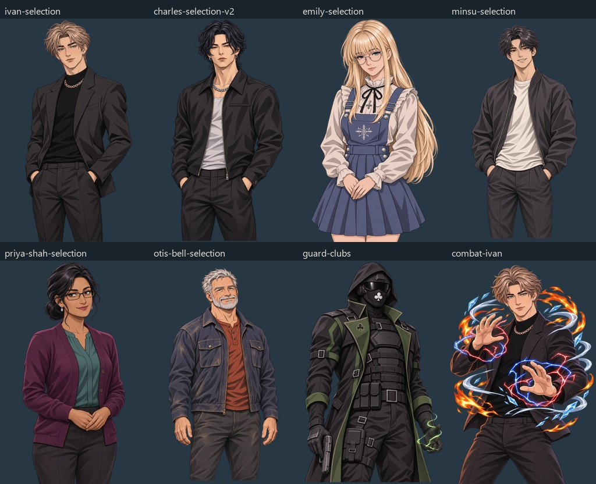

# MH-013 artwork patch — Batch 1

**Status:** Released for the eight-portrait pilot only. **Date:** 2026-11-10 (Australia/Brisbane). **Version:** unassigned. Full MH-013 remains In progress.

Batch 1 implements the representative pilot in the [production plan](../PORTRAIT_ARTWORK_UPDATE_PLAN.md). Eight 1024×1536 RGBA portraits now replace their existing runtime files. Originals are preserved outside live portrait discovery. The other 298 files in the 306-file baseline remain byte-identical.

## Installed scope

| Character / context | Runtime path | Review and correction |
| --- | --- | --- |
| Ivan civilian | `assets/portraits/ivan-selection.png` | Preserves freckles, ash-brown hair, grey-green eyes, studs, chain and black tailoring. Constructed pelvis and both trouser thighs; naturally pocketed hands. |
| Charles civilian | `assets/portraits/charles-selection-v2.png` | Preserves amber eyes, right-cheek mark, hoops, chain and jacket; full hairstyle and trouser thighs. The supplied opaque `charles-selection.png` is untouched. |
| Emily civilian | `assets/portraits/emily-selection.png` | Restrained matte skin and fabric shading with detailed blonde hair strands/highlights, glasses, ruffles, embroidery and clasped hands. The current portrait ends at true mid-thigh, with a short visible band of connected legs beneath the hem and no knees. |
| Minsu civilian | `assets/portraits/minsu-selection.png` | Softer face, modelled mouth and friendly smile; bomber, tee and pocketed hands retained. A second framing pass extends both thighs substantially below the crotch. |
| Priya Shah | `assets/portraits/priya-shah-selection.png` | Mature 38-year-old face and medium-brown complexion, bun, rectangular glasses, cheek mark, earrings, plum cardigan and teal blouse preserved; complete hands and trouser thighs. |
| Otis Bell | `assets/portraits/otis-bell-selection.png` | Robust 67-year-old face and build, silver hair/beard, weathering and navy/rust workwear preserved; full hands. A second framing pass gives meaningful thigh length. |
| Clubs guard | `assets/portraits/guards/clubs.png` | Opaque mask/visor, white/gold club emblems, olive trim, armour, pouches, holster, downward pistol and local green energy preserved. Complete gloves and mid-thigh coverage; no exposed identity. |
| Ivan combat | `assets/portraits/combat/ivan.png` | Derived from the accepted civilian master. Both hands, pelvis and thighs visible; original orange fire, cyan ice, silver wind and red/blue electricity retained. Effects stay within canvas without shrinking the body into a bust. |

## Integration and access

Restart the game. Preview Ivan, Minsu or Emily in character selection, or use the existing default outfit in their in-person scenes. Charles remains laboratory-bound and uses his active v2 path. Meet Priya and Otis through their existing routines. Clubs guards appear at existing Syndicate posts and encounters; Ivan's combat version appears only in combat. No new unlocks or changed activity routing.

`game.py` now fits these four known-height civilian masters using a shared 2:3 reference and the tallest pilot character as its scale reference: Ivan 193 cm, Charles 191 cm, Minsu 177 cm, Emily 154 cm. Using 193 as the reference prevents width fitting from collapsing Ivan and Charles to the same height. Images retain aspect ratio and bottom anchoring. Legacy wardrobes retain their former fitting; historical portraits, headquarters uniforms, save-selected clothes and custom portraits retain their existing precedence.

No save schema or migration. Existing relationships, wardrobe choices, campaign state, powers, guard IDs and custom imports remain. Restart clears image caches and loads fitting changes. The restored guard encounter test verifies the saved opponent and outfit identity; the existing selection, historical, uniform and camera checks cover their own fallback/precedence paths.

## Production evidence

- [Manifest](manifest.json): stable baseline audit IDs, exact runtime paths, original/new SHA-256, dimensions, actual alpha statistics, visible bounds and per-asset findings.
- [Exact prompt set and input roles](generation-records.json): 15 built-in `image_gen` generations, including seven superseded drafts after Emily's framing and rendering follow-ups. Exact model identity is not exposed by the tool. No CLI/API fallback was used.
- [Before/after 1](before-after-1.jpg) and [before/after 2](before-after-2.jpg); [alpha review 1](alpha-review-1.jpg) and [alpha review 2](alpha-review-2.jpg).
- [Originals](originals/), [accepted candidates](candidates/) and [rejected Emily draft](emily-rejected-floating-skirt.png). Candidate and installed bytes match generated outputs; no pixel cleanup, stretching or background replacement by code.
- [Rendered game evidence](screenshots/): 15 screenshots covering six normal/compact selection views, four solo/group views, Charles's laboratory, both residents and two combat sizes. Full outputs, face/hair/accessory/hand details, offline composites and representative normal/compact game screens were visually inspected. Phone review used the existing dark-theme interactive-state sheet.

Alpha inspection confirms genuinely clear exterior/gaps and opaque or near-opaque bodies. Most new body alpha peaks at 254; that is valid output, not a failed cutout. Updated combat/town checks permit 250–255 while still requiring clear pixels; combat also requires substantial solid body area. Apparent glows in raw generation previews lie in transparent pixels and do not appear in the slate, middle-value, light diagnostic or game composites. Combat's intentional energy is retained.

Framing tolerance: some accepted pilot crowns have less than the preferred 3–5% headroom and some clean thigh cutoffs meet the lower canvas edge. Full hairstyles, hands and side silhouettes remain inside the image; exact bounds are recorded rather than claiming uniform margins. Minsu and Otis have the larger revised margins. Emily's subsequent correction restores the requested mid-thigh limit; the previous longer-crop exception is withdrawn. No missing anatomy is hidden by padding or a floating garment.

## Emily mid-thigh follow-up — 2026-11-10

The user identified knees in the initially installed portrait. The [follow-up record](emily-mid-thigh-fix/README.md) covers the corrected image, exact prompt, previous-image backup, before/after hashes, inspection and checks. Only Emily's active/candidate image changed; the other seven pilot assets remained byte-identical. Release: `release-2026-11-10-emily-mid-thigh-crop`.

## Emily rendering refinement — 2026-11-10

The user requested less rendered detail while explicitly retaining detailed hair. The [rendering follow-up](emily-style-refinement/README.md) replaces glossy/soft skin and fabric rendering with cleaner matte shading, while restoring fine blonde strands and layered highlights. Identity, costume, connected legs and the corrected mid-thigh crop remain. The shared manifest, comparison sheets and pilot screenshots now show this latest revision. The other seven pilot assets remain byte-identical. Release: `release-2026-11-10-emily-rendering-refinement`.

## Initial Batch 1 verification

`python tools/verify_artwork_batch_01.py --installed` passed: eight RGBA 1024×1536 images decoded, genuine alpha and safe top/side silhouettes checked, baseline backups matched, installed hashes matched, exactly eight baseline files changed. It also regenerates inspection composites without changing portrait pixels.

`python tools/run_artwork_batch_01_checks.py units`: **61/63 tests passed** across nine suites. Portrait fitting (3), combat portraits (3), guard portraits (6), character selection (11), campaign flashbacks (6), Syndicate cast (6) and hangout scene (6) passed completely. Flashback visits passed 8/9; camera passed 12/13. [Exact commands and logs](checks/units.json).

Two failures are in unchanged behavior outside this artwork patch:

- `test_flashback_visits.test_real_save_resume_and_independent_campaign` expects `garrett-school-brother`; the current campaign returns `garrett-april-silence`. The save round-trip assertions before that expectation passed. No image loading or portrait fitting participates in this failing assertion.
- `test_camera.test_local_date_partner_can_join_photo` expects Theo in companions; the current fixture yields an empty companion list. This assertion runs before image selection. Wardrobe, custom outfit and reference tests passed.

`python tools/run_artwork_batch_01_checks.py smokes`: **13/13 scripts passed**: artwork pilot, character selection, start screen, town portraits, combat portraits, guard portraits, Syndicate uniforms, Syndicate guard encounters, campaign flashbacks, flashback visits, camera, dark-phone theme and patch-note reader. [Exact commands and logs](checks/smokes.json). The pilot was corrected to respect Charles's laboratory restriction and the residents' current routines; fixtures do not change those game rules. In-person activities remain in the in-person window. The dark-phone check covers 34 pages plus chat/contact/embedded control states, including combobox popups, readonly and disabled controls.

Patch-note schema validation and Markdown export passed. The patch-note unit suite passed **5/6**; historical source coverage still fails on the already-recorded missing `tests/screenshots/mixtape-art-review-0.jpg`. No replacement historical evidence was invented. [Publication checks](checks/patch_notes.json).

These are offline checks with provider calls mocked or disabled. No live AI dialogue or visual certification of future generations is claimed. Unchanged variants can still differ stylistically until later batches are produced; this release is not the full 295-portrait conversion.

## Rollback and next batch

Each manifest `original` corresponds to its exact `path`; copying those eight originals back restores baseline art. The pilot-specific fitting block in `game.py` must also be reverted when reverting the art. Do not put originals/candidates under `assets/portraits`, where wardrobe discovery could expose them. Historical generation manifests and the original audit stay intact.

Next: establish the remaining character masters, then propagate accepted identities through wardrobes before historical/uniform/combat production. Preserve stable MH-013 and asset audit IDs. Release record: `release-2026-11-10-artwork-batch-01` in `patch_notes/catalog.json`.
