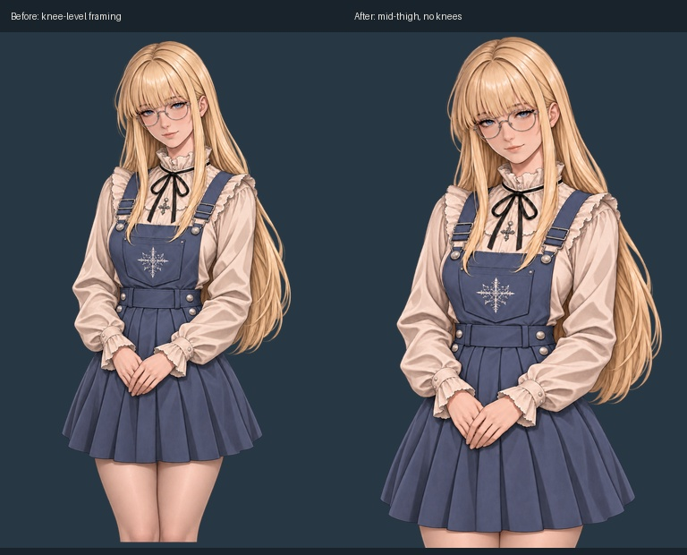

# MH-013 Emily mid-thigh framing correction

Released 2026-11-10 (Australia/Brisbane), following the user's observation that the installed portrait showed her knees.

The active `assets/portraits/emily-selection.png` now ends at true mid-thigh. A short visible band of both connected thighs remains below the skirt; knees and knee creases are outside the frame. Her face, blonde hair, glasses, outfit, jewellery, embroidery and clasped hands remain recognisable. This supersedes the earlier longer-crop exception in the art guide. The other seven Batch 1 portraits and all runtime fitting code are unchanged.

Created through one built-in `image_gen` edit. [Exact prompt and input](generation.json), [previous-image backup](before.png), [before/after hashes](change.json) and [three-background alpha review](alpha-review.jpg) are preserved. The accepted output was copied byte-for-byte to the active path and Batch 1 candidate; no pixel postprocessing. The Batch 1 manifest, contact sheet, alpha sheets, before/after sheets and game screenshots were refreshed.

Verification: RGBA 1024×1536 decode/alpha/hash checks passed; only Emily changed relative to the previous pilot manifest. Fourteen unit tests passed (three portrait-framing and eleven character-selection tests). The pilot UI smoke, character-selection smoke, start-screen smoke, dark-phone smoke and patch-note reader smoke passed. Full source framing and alpha composites were visually inspected, along with the corrected selection and in-person renderings. No knees or disconnected legs remain in those views.

The first start-screen smoke attempt failed on a widget mapping assertion; an unchanged rerun passed. Both attempts are retained. [Exact runtime commands and results](checks.json). Patch-note validation/export passed; the patch-note unit suite remains 5/6 because of the previously recorded missing historical `tests/screenshots/mixtape-art-review-0.jpg`. [Publication commands and results](publication.json). Earlier Batch 1 test results are historical and were not all rerun for this single-image correction.

Restart to clear cached portrait images. Existing saves, selected outfits, character height fitting, relationships and activity routing are unchanged; no migration. The correction uses Emily's existing default/selection portrait route. Record: `release-2026-11-10-emily-mid-thigh-crop` in `patch_notes/catalog.json`.
