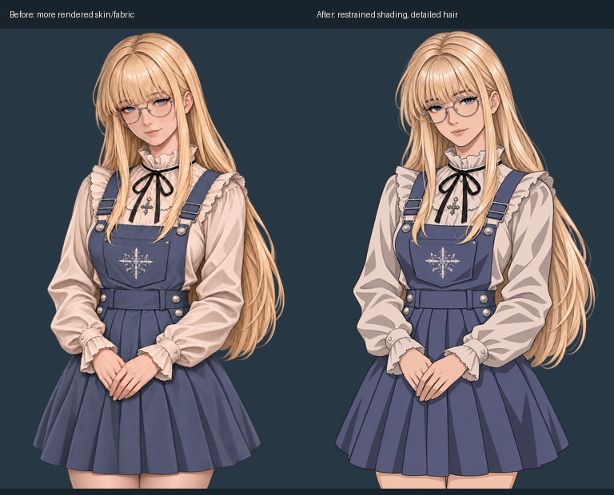

# MH-013 Emily rendering refinement

Released 2026-11-10 (Australia/Brisbane). The user requested less detailed/rendered artwork, then clarified that the hair should remain detailed.

The installed `assets/portraits/emily-selection.png` uses simpler matte skin and fabric shading, clearer shadow shapes and less fabric microtexture. Detailed blonde strands, layered locks and highlights are retained. Her blue eyes, round glasses, gentle expression, cream ruffled blouse, embroidered blue pinafore, pendant and complete clasped hands remain recognisable. The previous mid-thigh correction is preserved: short connected thigh sections below the skirt, no knees.

Three built-in `image_gen` calls produced two superseded drafts and the installed result. The first simplified her facial construction too far; the second restored facial structure but still simplified the hair. The final edit restores detailed hair using the previous installed image as its hair reference. [Exact prompts and input roles](generation-records.json), [previous installed image](before.png), [hash comparison](change.json) and [alpha review](alpha-review.jpg) are retained. No pixel postprocessing was applied to the installed PNG.

Only Emily changed relative to the saved prior pilot manifest; the other seven pilot images are byte-identical. The 306-file baseline still differs at exactly the eight original Batch 1 paths. No runtime fitting, wardrobe precedence, game mechanics or save fields changed. The artwork guide now explicitly preserves detailed hair when simplifying skin and fabric. The Batch 1 manifest, comparison sheets and game screenshots reflect this latest revision.

Fourteen unit tests passed (three portrait-framing and eleven character-selection tests). The asset validator and four runtime UI smokes passed: artwork pilot, character selection, start screen and phone dark theme. [Exact commands/results](checks.json). Source artwork, three-background alpha comparisons and the in-person rendering were visually inspected for hair detail, identity, hands, true mid-thigh coverage and clear transparency. Broader initial Batch 1 suites were not rerun for this image-only refinement.

Publication checks are recorded separately in [publication.json](publication.json). Patch-note reader smoke, catalogue validation and export passed. The patch-note unit suite passed 5/6; historical source coverage still fails on the previously recorded missing `tests/screenshots/mixtape-art-review-0.jpg`.

Restart to clear cached portrait images, then use Emily's existing default/selection portrait route. No save migration. Release record: `release-2026-11-10-emily-rendering-refinement`. Earlier crop and Batch 1 releases remain historical records.
